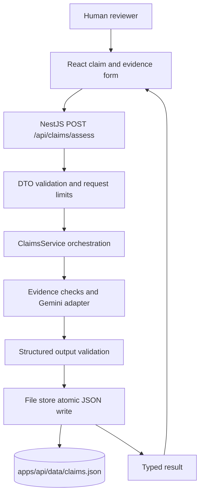

# L'Oréal Claims Intelligence Engine

An MVP decision-support tool for comparing a proposed cosmetic claim with plain-text clinical evidence. The model highlights support, contradictions, and missing evidence; it does not provide regulatory or scientific approval. A qualified human reviewer always makes the final decision.

## Workflow and architecture



1. The browser sends the claim and synthetic/plain-text study summary to the NestJS API.
2. NestJS validates shape and lengths before calling the injectable AI adapter.
3. The server-side Google Gemini API requests JSON using a response schema and validates the returned values again.
4. A conservative numerical guardrail rejects a measured percentage below the claimed percentage when both state the same explicit duration.
5. The file store atomically replaces the JSON file containing the claim and assessment; the API responds only after persistence succeeds.
6. The UI displays status, reasoning, and explicitly uncalibrated model confidence for human review.

React handles presentation; the controller owns HTTP/validation; the service coordinates assessment and persistence; the AI adapter isolates vendor calls. NestJS dependency injection makes deterministic provider and persistence tests straightforward. The current MVP stores claim history in a local JSON file under `apps/api/data/claims.json` (or the configured `CLAIMS_DATA_FILE`). PostgreSQL/Prisma support remains in the project, including its schema and migration, but is disabled in the active app module for now. A synchronous request keeps this one-day MVP small; a production system should move longer work to a queue.

## Data model and status semantics

- `Claim` stores the proposed text and timestamps.
- `Assessment` stores evidence, model, status, reasoning, confidence, and timestamp. One claim can have multiple independent assessments.
- An initial submission writes the claim and its first assessment together to the JSON file.
- `JUSTIFIED` maps to `justified: true`. `NOT_JUSTIFIED` and `INSUFFICIENT_EVIDENCE` map to `false` and remain distinct in the response.
- Confidence is an **uncalibrated model estimate**, not a statistical confidence interval or approval probability. Values are checked in `[0,1]`; the retained PostgreSQL schema could later add a database-level check as further hardening.

## API

### `POST /api/claims/assess`

Request:

```json
{
  "claim": "Reduces wrinkles by 20% in 4 weeks",
  "evidence": "In 100 participants, mean wrinkle depth decreased by 12% at week 4."
}
```

Response example (illustrative, not a live model result):

```json
{
  "claimId": "uuid",
  "assessmentId": "uuid",
  "justified": false,
  "status": "NOT_JUSTIFIED",
  "confidence": 0.93,
  "reasoning": "Observed reduction is below the claimed amount."
}
```

The claim is limited to 10–500 characters; evidence to 20–20,000 characters; JSON bodies to 64 KiB. Unknown fields and invalid UUIDs are rejected. The service returns 400 for invalid input, 503 for unavailable/unconfigured AI, 404 for an unknown claim, and a generic 500 on persistence failure without returning internal DB/provider details.

### `GET /api/claims/:id`

Returns the claim and its assessments in newest-first order. `id` must be a UUID.

## Setup

Requirements: Node.js 20+, npm 10+. PostgreSQL is not required while file-based storage is active.

```sh
npm install
cp .env.example .env
# Set GEMINI_API_KEY in .env to enable live assessment; it stays server-side.
npm run dev:api
```

In another terminal:

```sh
npm run dev:web
```

The API listens on `http://localhost:3000/api`; Vite serves the UI at `http://localhost:5173`. Configure `FRONTEND_ORIGIN` to the exact trusted browser origin. A missing key does not prevent app startup, but assessments return 503. The default model is `gemini-3.5-flash-lite`, as recommended by Google AI Studio for this account. The request uses minimal thinking, concise instructions, and a 256-token response limit; it omits deprecated sampling parameters. Set `GEMINI_MODEL` and `GEMINI_TIMEOUT_MS` to configure the server adapter. The provider timeout is 60 seconds by default, with no SDK retries to avoid waiting through repeated upstream deadlines; the browser allows up to 125 seconds. The browser only receives `VITE_API_BASE_URL`, never the Gemini key. By default JSON data is stored in `apps/api/data/claims.json`; set `CLAIMS_DATA_FILE` to an absolute path or a path relative to the API working directory to use a different file.

The Gemini key supplied in chat is not written to project files. Since it was shared in chat, revoke it in Google AI Studio and create a replacement. Store the replacement only in the ignored root `.env` file as `GEMINI_API_KEY=...`.

### Returning to PostgreSQL later

The original PostgreSQL schema, migrations, Prisma module/service, and persistence implementation comments have been retained. To restore DB persistence, re-enable `PrismaModule` in `apps/api/src/app.module.ts`, restore the Prisma injection and nested-create code in `ClaimsService`, and then run the Prisma setup below. The active application does not currently initialize a PostgreSQL connection.

```sh
npm run db:migrate
```

For schema changes during local development, create/apply a migration with:

```sh
npm run db:migrate:dev --workspace @claims/api -- --name describe-change
```

## Tests and checks

```sh
npm test
npm run typecheck
npm run build
npm run lint
```

The API unit tests mock the AI provider and file store; dedicated file-store tests verify JSON persistence and concurrent writes. HTTP tests exercise validation and route wiring with a mocked service. UI tests cover accessible fields, request payload, results, and provider failure. They do not require a live model or database.

**Verification record (2026-10-30):**

- `npm test` — passed: API 34 tests across 5 suites; web 5 tests in 1 suite; 39 passed, 0 failed, 0 skipped.
- `npm run typecheck` — passed for API and web.
- `npm run build` — passed for NestJS API and Vite production web build.
- `npm run lint` — passed for API and web.
- Prisma schema validation — passed. No database connection or migration is used by active file storage.
- File-backed HTTP test — passed with a mocked AI provider: `POST /api/claims/assess` persisted to a temporary JSON file and `GET /api/claims/:id` returned the saved claim and assessment.
- API startup without PostgreSQL — passed; HTTP GET returned the expected 404 for an unknown claim. A live `POST` without an API key correctly returned 503 and did not create an assessment file.
- Browser smoke check — Vite page loaded and accessible claim/evidence fields, disabled submit state, and initial result state were present. Automated Playwright E2E was not configured or run.
- Live Gemini smoke test — not run; no credential was configured in the workspace.
- Gemini request settings — using `gemini-3.5-flash-lite` with minimal thinking, concise prompt, 256 output tokens, and no deprecated temperature/top-p/top-k parameters. No live model call was made; model availability and request acceptance still depend on Google AI Studio service and account access.
- `npm audit --omit=dev` — 0 production dependency vulnerabilities. Full `npm audit` reports 8 low-severity findings in development tooling (Jest/Nest CLI dependency tree); no high or critical findings remain.

## Security, privacy, and limitations

- Keep `.env` out of source control. The Gemini key is only read in the server process and is never returned to the browser. The previous OpenAI adapter code is retained as a comment in the API AI service; it is not active.
- Do not submit real patient/clinical personal data. Use synthetic evidence for development and demos. Organizational privacy and retention requirements still need formal review before production.
- Evidence is passed as data separately from system instructions and explicitly treated as untrusted. Strict output shape and runtime validation reduce malformed responses, not model hallucination.
- Provider errors are converted to a generic 503; persistence failures return a generic server error. Full evidence and credentials are not logged.
- The numeric guardrail is intentionally narrow: it compares explicit percentages, matching text endpoints, and equal stated durations; it is not a scientific validator and cannot verify formulation, population or study quality.
- File storage is intended for local MVP use, not multi-instance production: it rewrites a single JSON file, has no cross-process locking, and should be replaced by PostgreSQL when concurrent deployment or stronger durability is required.
- Plain-text input only. No PDF parsing, efficacy validation, approval workflow, authentication, rate limiting, or calibrated model evaluation in this MVP.

## Trade-offs and roadmap

No Kafka, Redis, or Kubernetes for a one-day synchronous MVP. Future work: PDF extraction with human-verified citations, structured study metadata, validated scientific rules, evidence retrieval, formal human approval and audit trail, role-based access, request rate limiting, queued work for long studies, observability, model evaluations/calibration, and multilingual/regulatory localization.

## Panel walkthrough

See [PRESENTATION.md](./PRESENTATION.md) for a 10-minute demo plan and anticipated questions.
